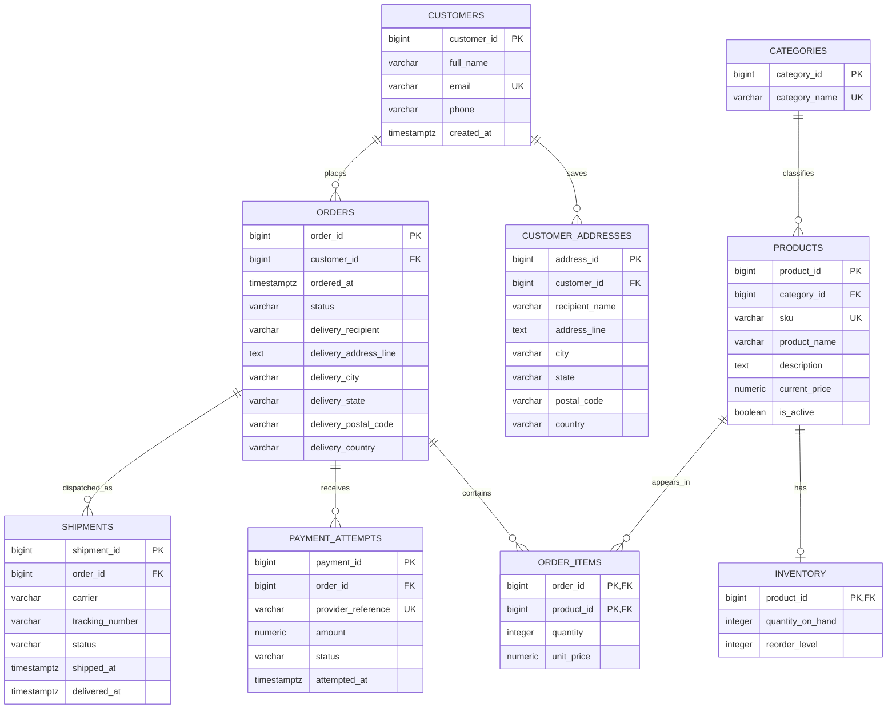

# MarketHub entity–relationship diagram

`||` means exactly one; `o{` means zero or many; `o|` means zero or one. A placed order must have one or more items, although drafts and the foreign-key structure allow zero. The product-creation workflow requires inventory even though the foreign key alone allows its absence. Tracking number is unique within its carrier, rather than globally unique.
