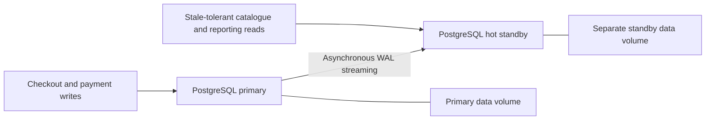

# MarketHub distributed database architecture and analysis

## Topology

Application boxes represent proposed routing, not deployed application services. The two actual database servers communicate on one dedicated internal Docker network with no host-published ports. Both run on one machine. The P4 MongoDB catalogue remains a separate snapshot; it is not part of PostgreSQL physical replication.

## What replication does

The recorded experiment used PostgreSQL 18.3 on 12 November 2026 and passed all 19 checks. The actual results are summarised below; raw SQL/commands and outputs are retained in the execution transcript.

| Observation | Recorded result | Evidence |
|---|---|---|
| Streaming connection | `streaming`, `async`, active physical slot | [Final replication status](evidence/replication-final.txt) |
| Primary commit while replay paused | Keyboard price NGN 18,000 | [Primary update](evidence/committed-primary-update.txt) |
| Standby read during pause | Keyboard price NGN 15,000, state `paused` | [Stale read](evidence/stale-standby-read.txt) |
| Resume and catch-up | Standby keyboard price NGN 18,000 | [Caught-up catalogue](evidence/standby-after-catchup.txt) |
| Standby write attempt | SQLSTATE `25006`, rejected | [Read-only error](evidence/standby-write-rejected.txt) |
| Primary outage | Primary container stopped; standby stayed read-only | [Stopped primary](evidence/primary-outage.txt), [write rejection](evidence/outage-standby-write-rejected.txt), [test assertions](evidence/verification.txt) |
| Restart and further replication | Mouse NGN 5,500; final catalogues equal | [Primary](evidence/final-primary.txt), [standby](evidence/final-standby.txt) |

The historical order total remains NGN 35,000 despite catalogue price updates. These changes occur only in this new replication pair, not the earlier portfolio databases.

PostgreSQL records changes in its write-ahead log. The standby begins from a physical base backup and receives/replays subsequent WAL. This copies the database cluster's physical changes rather than translating the tables into MongoDB documents or exporting SQL rows repeatedly. The lab verifies data replication and the active asynchronous sender connection; it is not application-level dual writing.

The physical replication slot retains WAL required by the standby, subject to the configured 128 MB slot-retention limit and checkpoint behaviour. That limit bounds one source of retained WAL; it does not guarantee immediate disk usage below exactly 128 MB. If a standby falls too far behind, the slot can become unusable and a new backup/reseed may be needed. Monitor slot state, WAL storage, replication connection, and replay progress rather than treating a slot as a backup.

## Consistency and stale reads

The replay-pause experiment establishes that a committed primary value need not immediately be visible on an asynchronous standby. The primary keyboard price becomes NGN 18,000 while the paused standby returns NGN 15,000. Once replay resumes, the standby converges. Receipt/flush/replay LSNs identify WAL positions; they are not interchangeable with a universal lag duration. The test does not measure normal network latency or intentionally interrupt the replication network.

MarketHub should route authoritative inventory and payment decisions to the primary. A buyer completing checkout should not rely on stale standby stock. A user reading immediately after their own write can also need primary routing or a mechanism that waits for a required replay position; that routing mechanism is proposed, not implemented. Catalogue browsing and historical reporting may tolerate a stated freshness delay, depending on business requirements.

Synchronous replication can make commit wait for a configured standby acknowledgement. What is acknowledged depends on settings: waiting for receipt/flush is different from waiting for replay (`remote_apply`). It can reduce a particular data-loss window but adds latency and may block writes when the required standby is unavailable. It is discussed here, not configured or benchmarked.

## Availability and the outage test

The primary is stopped cleanly after the standby has caught up. The original primary endpoint becomes unavailable, while the standby continues read-only catalogue queries. It remains in recovery and rejects writes. Restarting the same primary allows the standby to reconnect, and a later update replicates successfully.

This demonstrates **continued standby read availability** and a **write outage**. It does not demonstrate automatic failover, standby promotion, client endpoint switching, split-brain prevention, or recovery after an unclean crash. The standby's tested SQL reads are not a test of an application continuing to serve customers.

For automated failover, a real system needs health assessment, leader election/quorum or an appropriate managed mechanism, fencing of the old primary, promotion, client routing, and rebuilding the old primary as a follower before it can safely rejoin. Promoting without fencing can produce two independent writable primaries. None of those behaviours should be inferred from merely having a replica.

## Recovery objectives and backups

Asynchronous replication can lose acknowledged primary transactions if they were not durably replicated before an unrecoverable primary failure. The lab deliberately uses a planned stop after catch-up, so it does **not measure** that loss window or establish zero RPO. RPO concerns acceptable data loss; RTO concerns acceptable recovery time. Neither a numerical production RPO nor RTO is established by this run.

Replication also copies logical mistakes such as an unwanted committed deletion. Keep separate tested backups and, where appropriate, archived WAL for point-in-time recovery. Separate Docker volumes on the same host do not replace off-host backups or independent failure domains. Restarting the same primary is recovery of that server, not failover to a different writable server.

## How this maps to a cloud deployment

This is a proposed architecture, not a provisioned service or current-price comparison:

| Lab element | Proposed cloud equivalent | What still needs verification |
|---|---|---|
| Local primary container | Managed PostgreSQL writer or secured PostgreSQL VM | Supported versions, backups, capacity, access controls |
| Local standby container | Provider-supported standby/read replica in another failure domain | Whether it serves reads, replication mode, promotion/failover semantics |
| Internal Docker network | Private cloud network and restricted database rules | Authentication, TLS, routing, separation from public access |
| Docker volumes | Managed persistent storage | Durability, encryption, backup/restore and retention policies |
| Manual inspection/runner | Monitoring, alerts, deployment/runbooks | Lag, disk/WAL growth, connection health, recovery exercises |

Do not assume that every provider's high-availability standby is a readable replica or that every read replica automatically fails over. Actual service capabilities, limits, pricing, and availability must be checked when choosing a provider. No account, paid cloud resource, public endpoint, or deployment evidence is claimed here.

## Sharding discussion

Replication copies the same data for resilience/read distribution. Sharding divides data across independent database nodes to distribute storage and work. This lab implements replication only.

If MarketHub outgrows one writer, one possible proposal is sharding customers and their orders by customer ID, colocating an order with its customer and items. That would require suitable globally unique IDs or routing-aware identifiers and an explicit shard-routing layer; independent identity sequences must not be assumed globally unique. Cross-customer reports need aggregation across shards.

Products and inventory are shared by buyers on multiple customer shards. A single product's stock therefore cannot simply be copied as separately writable balances. A central inventory authority, carefully allocated stock partitions, or distributed coordination would be required. Payment idempotency and all-or-nothing checkout across boundaries also become harder. Table partitioning inside one PostgreSQL instance is not the same as distributed sharding. No sharding, cross-shard transaction, or distributed checkout is implemented.

## Practical conclusion

The lab supplies a working replicated MarketHub database and observable tradeoffs: asynchronous replay permits stale reads; a standby can serve reads during the planned primary stop; writes remain unavailable without a writer; and restart restores replication. The results support discussion of consistency, availability, and cloud architecture while keeping untested disaster recovery, automatic failover, and sharding claims separate.
